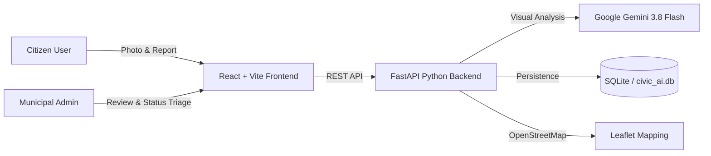

# Civic AI — AI-Powered Grievance Redressal Platform

**Civic AI** is a full-stack civic technology web platform designed to empower citizens to report public infrastructure and municipal service grievances (hazardous potholes, overflowing garbage dumps, dark/broken streetlights, sewer leakage, and damaged amenities).

Using Google Gemini Multimodal AI, Civic AI verifies uploaded photographic evidence, checks civic relevance, suggests probable defect categories, drafts formal municipal complaint letters, and pins geographic coordinates on OpenStreetMap.

---

## Architecture & Tech Stack



- **Frontend**: React 18, Vite, TypeScript, Tailwind CSS, Lucide React icons, Leaflet & React Leaflet, Axios, React Router v6.
- **Backend**: Python 3.11+ (Python 3.14 verified), FastAPI, Pydantic v2, SQLAlchemy 2.0 ORM, SQLite (`civic_ai.db`), Pillow for image sanitation, `google-genai` SDK.
- **Testing**: Pytest with in-memory SQLite isolation, temporary file mock storage, and 100% test pass rate across 17 automated tests.
- **Deployment**: Multi-stage containerized Docker configuration for Hugging Face Spaces (port 7860).

---

## Quick Start for Windows & PowerShell

### Prerequisites
- [Python 3.11+](https://www.python.org/downloads/)
- [Node.js v18+](https://nodejs.org/)
- Windows PowerShell

---

### Step 1: Start the Backend Server

1. Open PowerShell and navigate to the backend directory:
   ```powershell
   cd "d:\Projects\Civic AI\backend"
   ```

2. Activate the pre-configured virtual environment:
   ```powershell
   .\venv\Scripts\Activate.ps1
   ```
   *(Note: If PowerShell displays a script execution policy notice, run: `Set-ExecutionPolicy -ExecutionPolicy RemoteSigned -Scope CurrentUser`)*

3. Create your local `.env` file:
   ```powershell
   Copy-Item .env.example .env
   ```

4. Initialize database and seed realistic demo records:
   ```powershell
   python -m app.cli init-db
   python -m app.cli seed-demo
   ```
   *(This creates 5 sample complaints across categories and generates the demo admin account).*

5. Start the FastAPI development server:
   ```powershell
   python -m uvicorn app.main:app --reload --port 8000
   ```
   - API is running at: `http://localhost:8000`
   - Interactive Swagger API docs: `http://localhost:8000/docs`
   - Health check: `http://localhost:8000/api/health`

---

### Step 2: Start the React Frontend

1. Open a **new tab** or new PowerShell window:
   ```powershell
   cd "d:\Projects\Civic AI\frontend"
   ```

2. Create your frontend environment configuration:
   ```powershell
   Copy-Item .env.example .env
   ```

3. Start the Vite development server:
   ```powershell
   npm run dev
   ```

4. Open your browser and navigate to:
   ```
   http://localhost:5173
   ```

---

## AI Configuration & Gemini Setup

Civic AI is configured to use the Google Gen AI SDK with **Gemini 3.8 Flash** (`gemini-3.8-flash`) by default.

### Option A: Using Offline Mock Mode (Zero Setup, No API Key Required)
In `.env`:
```env
AI_MOCK_MODE=true
```
Civic AI will run a deterministic, realistic visual and text generation simulation. The UI will explicitly display a `[Demo Mode]` pill and transparent notice indicating that simulated results are active. This is ideal for testing, automated workflows, and continuous integration.

### Option B: Using Live Google Gemini Vision
1. Obtain a free API key at [Google AI Studio](https://aistudio.google.com/).
2. In `backend/.env`, set:
   ```env
   GEMINI_API_KEY=AIzaSyYourActualKeyHere
   GEMINI_MODEL=gemini-3.8-flash
   AI_MOCK_MODE=false
   ```
3. Restart the backend server. Gemini will now analyze all uploaded photographs and dynamically draft grievance letters in real-time.

---

## Administrator Portal & Credentials

Civic AI includes a secured administrative triage dashboard at `http://localhost:5173/admin` for municipal engineers and ward supervisors.

- **Demo Admin Email**: `admin@civicai.local`
- **Demo Admin Password**: `AdminPass2026!`

To create a new custom administrator from the CLI:
```powershell
cd "d:\Projects\Civic AI\backend"
.\venv\Scripts\Activate.ps1
python -m app.cli create-admin --email supervisor@ward12.gov --password "StrongPass2026!" --name "Ward Supervisor"
```

---

## Running Automated Tests

To run the complete automated Pytest test suite:
```powershell
cd "d:\Projects\Civic AI\backend"
.\venv\Scripts\Activate.ps1
pytest -v
```

All 17 tests run in complete database isolation using an in-memory SQLite database and temporary upload sandbox.

To run the frontend production build and type check:
```powershell
cd "d:\Projects\Civic AI\frontend"
npm run build
```

---

## Deploying to Hugging Face Spaces

1. Create a new Space on [Hugging Face Spaces](https://huggingface.co/new-space).
2. Select **Docker** as the Space SDK.
3. In Space Settings, add the following secrets:
   - `GEMINI_API_KEY`: *(Your Gemini API Key)*
   - `GEMINI_MODEL`: `gemini-3.8-flash`
   - `AI_MOCK_MODE`: `false` (or `true` if you want demo mode)
   - `SECRET_KEY`: *(Any 32-character random string)*
4. Push this repository to your Space remote:
   ```powershell
   git remote add space https://huggingface.co/spaces/<your-username>/civic-ai
   git push space main
   ```
The Dockerfile will build the React application, package the FastAPI backend, initialize the database, and serve both on port `7860`.

---

## Responsible AI & Public Notice

- **Advisory Role**: AI analysis is presented as advisory assistance for citizens and municipal staff.
- **Privacy First**: Face recognition and personal biometric profiling are strictly disabled in prompt guidelines.
- **No Hallucinations**: Letter generation is instructed to use explicit placeholders (e.g. `[Local Municipal Corporation]`, `[Ward Office]`) rather than fabricating officer names, designations, or nonexistent legal codes.
- **MVP Scope**: Complaints are recorded and managed within Civic AI. They are not transmitted to real municipal authorities unless an official integration has been configured.

---

## License
MIT License
