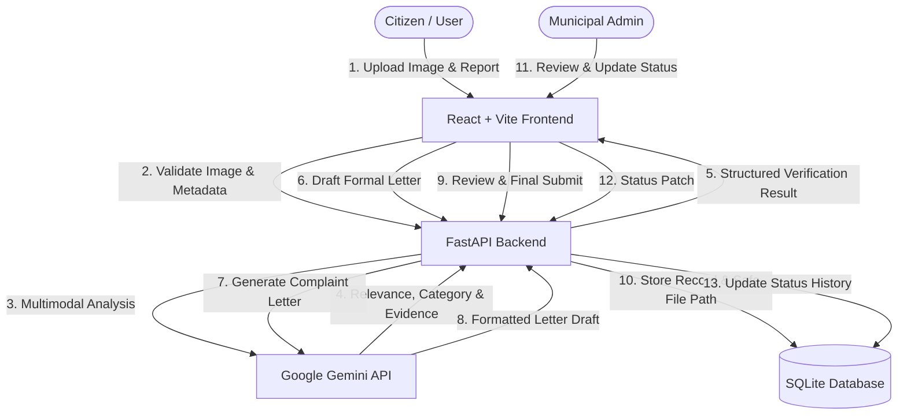

# Civic AI Architecture Documentation

## 1. System Overview

Civic AI is an AI-powered grievance redressal platform engineered to bridge the communication gap between citizens and municipal authorities. It provides an end-to-end pipeline:
1. **Intake**: Multi-step reporting wizard with image upload and OpenStreetMap pin placement.
2. **AI Verification**: Computer vision and multimodal reasoning via Google Gemini API to analyze uploaded images for civic relevance, detect category, extract factual evidence, and flag non-civic photos (e.g. selfies, memes, landscapes, blank images).
3. **Drafting Assistance**: Automated generation of formal, respectful, and legally sound municipal grievance letters without hallucinating government officers or fake statute numbers.
4. **Tracking & Transparency**: Unique tracking reference (`CIV-YYYYMMDD-XXXX`), status workflow (`Submitted`, `Under Review`, `In Progress`, `Resolved`, `Rejected`), and public/admin views.
5. **Insights**: Aggregated civic issue analytics, category distribution, and geolocation map.

---

## 2. Component Architecture

### 2.1 Frontend (`frontend/`)
- **Runtime & Bundler**: Vite 5+ with TypeScript and React 18/19.
- **Styling**: Tailwind CSS for responsive, accessible, high-contrast civic tech design.
- **Routing**: `react-router-dom` v6 for clean single-page app (SPA) navigation.
- **Mapping**: Leaflet and `react-leaflet` connected to OpenStreetMap raster tiles with reverse geocoding fallback.
- **Icons**: `lucide-react` for clean, lightweight iconography.
- **State & HTTP**: Centralized Axios API client configured with error handling, interceptors, and environment-driven base URLs.

### 2.2 Backend (`backend/`)
- **Web Framework**: FastAPI (high-performance Python asynchronous web framework).
- **Validation**: Pydantic v2 schemas for strict request/response type validation and OpenAPI documentation.
- **Database Layer**: SQLAlchemy 2.0 ORM with SQLite database engine (`civic_ai.db`).
- **File & Media Handling**: Pillow (`PIL`) for server-side image MIME inspection, dimensions check, format conversion, and sanitization.
- **AI Service**: Google Gen AI SDK (`google-genai`) using supported models (`gemini-3.8-flash` by default, configurable via `GEMINI_MODEL`).
- **Resilience & Mock Mode**: `AI_MOCK_MODE` switch for offline development, automated testing, or API quota exhaustion, returning clearly marked simulated results.
- **Security & Auth**: JWT tokens (`pyjwt` / `python-jose`), password hashing (`passlib` with bcrypt / pbkdf2), role-based access control (`citizen` vs `admin`).

---

## 3. Data Flow & Security Model

1. **Untrusted Input Processing**:
   - Filenames are never trusted; uploaded files are renamed to UUID-based hashes (`uploads/<uuid>.<ext>`).
   - Magic bytes and image headers are verified via Pillow before saving.
   - File size is capped (default 10MB) both in streaming upload validation and reverse proxy settings.
2. **AI Safety & Privacy**:
   - Prompt instructions forbid extracting personal biometric details, face recognition, or naming individuals.
   - Letters explicitly mark missing facts as placeholders rather than inventing data.
   - Mock outputs are flagged as `is_mock: true` to prevent false claims of AI verification.
3. **Authorization**:
   - Public users can submit complaints and track by reference number without an account.
   - Registered citizens can view their submission history.
   - Status updates and admin stats are protected by JWT Bearer token authentication with role verification (`role == "admin"`).
